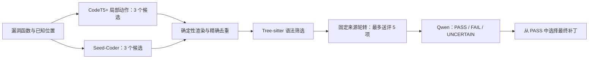

# LA-HPR

[](https://github.com/zzzxc643/LA-HPR/actions/workflows/verify.yml)
[](https://github.com/zzzxc643/LA-HPR/actions/workflows/containers.yml)

**基于局部动作与多源协同的 C/C++ 单行漏洞修复。**

LA-HPR 面向已知漏洞位置的 C/C++ 函数：CodeT5+ 根据局部上下文生成编辑动作，Seed-Coder 提供独立候选，经确定性渲染、精确去重与语法筛选后，由 Qwen 按三态语义协议选择补丁。本仓库提供实验数据索引、逐样本结果、生成与评审脚本、工程检查协议、数据重建工具及 Docker 环境。

LA-HPR is a C/C++ vulnerability repair research artifact combining local edit actions, multiple candidate sources, and semantic patch selection under supplied fault locations.

**当前版本：** 2026-11-01 整理发布，结果覆盖截至 2026-10-28 已完成实验。下表采用最新六候选协议，原六组实验与早期编译子集另行保留，详见 [实验结果](EXPERIMENTS.md)。

## 方法流程



局部输入保留目标行前后各 8 行及必要的函数签名；评审读取完整原函数、定位行号和候选差异。生成与评审均不接收参考替换文本。正式实验的规则候选数为 0，JSON 输出经生成后校验，未使用受限解码。

## 最新结果

最新对照统一最多生成 6 个原始候选、去重及语法筛选后最多送评 5 个。LA-HPR 对应冻结记录中的 `mixed33`；Seed6 使用 Seed 的 6 个候选；全函数 beam6 使用 CodeT5+ 生成完整函数。

| 方法 | Prime57 静态推荐 | Prime57 工程接受 | Mega141 静态推荐 | Mega141 工程接受 |
|---|---:|---:|---:|---:|
| CodeT5+ 全函数 beam6 | 20/57（35.1%） | 19/57（33.3%） | 52/141（36.9%） | 48/141（34.0%） |
| Seed6 | 28/57（49.1%） | 24/57（42.1%） | 98/141（69.5%） | 90/141（63.8%） |
| **LA-HPR / Mixed33** | **32/57（56.1%）** | **29/57（50.9%）** | **101/141（71.6%）** | **94/141（66.7%）** |

**静态推荐**指 Qwen 的合法 PASS 选择，**工程接受**指所选补丁在真实工程参数下通过语法与类型检查，并通过目标函数体及修改行激活控制。它们均不等价于执行测试证明的漏洞修复正确率。所有样本保留在各自分母中。

Prime57 与 Mega141 的原函数/参考函数工程控制分别通过 **57/57** 和 **141/141**，采用 Clang **20.1.2**。这是数据与环境控制，不能计为模型修复成功。两批结果分别报告。

全函数 beam6 复用 Train416 检查点，LA-HPR 的局部模型训练量为 451；候选数量一致不代表训练数据、计算量或 Token 成本一致。该全函数基线参考 VulRepair 构建，属于适配实验。终止评审格式错误、输入超限、上下文依赖及更多逐样本证据见 [EXPERIMENTS.md](EXPERIMENTS.md)。

## 数据范围

| 数据 | 规模 | 用途 |
|---|---:|---|
| PrimeVul 单行 Train / Valid / Test | 451 / 69 / 57 | 已冻结训练、验证和核心测试划分 |
| MegaVul 扩充评价池 | 141 对、84 个暂定关联组 | 未重新分配 Train/Valid/Test 的扩充评测 |
| PrimeVul 多区间 Train / Valid | 3287 / 439 | 开发阶段的表示与渲染扩展，含相应单行子集 |

任务中的位置由参考差异预先提取，研究范围是**给定定位信息的修复**。MegaVul 评价池不作为新的训练集，且不宣称项目互斥的独立泛化。多区间与单行数据不能合并计数；401 条 Overall Test 尚无本仓库发布的实验结果。[DATA_CARD.md](DATA_CARD.md) 说明来源、字段、划分与指标口径。

## 无卡快速核验

Python 3.10+，仅使用标准库，不调用模型或付费 API：

```bash
git clone https://github.com/zzzxc643/LA-HPR.git
cd LA-HPR
python scripts/verify_artifact.py
```

脚本检查文件完整性、样本身份、PASS 选择、所选补丁哈希与工程结果绑定，并复算最新对照及原始实验统计。独立核验最新结果也可运行 `python scripts/verify_updates.py`。

Docker 入口：

```bash
docker run --rm ghcr.io/zzzxc643/la-hpr:verify-20261101
```

## 数据重建

**PrimeVul：** 按 [官方 v0.1 下载说明](https://github.com/DLVulDet/PrimeVul) 获取三个 `primevul_{train,valid,test}_paired.jsonl` 文件，然后运行：

```bash
python scripts/reconstruct_data.py --primevul-dir /path/to/PrimeVul_v0.1 --out rebuilt-primevul
```

**MegaVul：** 按 [来源记录](provenance/megavul_source.json) 获取实验使用的原始 JSON 镜像，然后运行：

```bash
python -m pip install -r requirements/data.txt
python scripts/reconstruct_megavul.py --megavul-json /path/to/megavul.json --out rebuilt-megavul141
```

输出目录须尚不存在。PrimeVul 重建全部 11 个冻结文件；MegaVul 重建 141 条输入与参考。脚本验证上游身份、函数与提示哈希、参考渲染及输出字节；MegaVul 输入恢复历史 CRLF，公开参考文件排除私有工程证据路径。重建已通过验证。

## 运行环境与复现范围

| 镜像 | 用途 |
|---|---|
| `ghcr.io/zzzxc643/la-hpr:verify-20261101` | 无卡结果核验及数据重建 |
| `ghcr.io/zzzxc643/la-hpr:compiler-20261101` | Ubuntu 24.04、Clang 20.1.2 与工程检查基础工具 |
| `ghcr.io/zzzxc643/la-hpr:gpu-20261101` | Python 3.12、PyTorch 2.8.0+cu128、Transformers 4.51.3 |

镜像为 `linux/amd64`，固定摘要见 [镜像清单](protocols/container_images.json)，运行与挂载方法见 [CONTAINERS.md](CONTAINERS.md)。GPU 镜像验证依赖导入与版本；实际 CUDA 运行需要宿主 GPU、驱动和容器支持。

当前发布支持**数值复核、数据重建与环境准备**。训练权重按维护者选择暂不公开；生成补丁正文、原始 API 缓存和完整工程源树也不在发布包中。重新生成需要相应检查点，工程复跑需要按上游提交恢复源码及配置。详见 [REPRODUCIBILITY.md](REPRODUCIBILITY.md)。

## 目录与证据入口

| 路径 | 内容 |
|---|---|
| [data/updates/equal_budget](data/updates/equal_budget) | 最新 Seed6 与 LA-HPR / Mixed33 逐样本结果 |
| [data/updates/fulltext6](data/updates/fulltext6) | 最新全函数 beam6 基线及终止错误协议 |
| [data/updates/prime57_clang20](data/updates/prime57_clang20) | Prime57 全覆盖工程检查 |
| [data/updates/megavul141](data/updates/megavul141) | Mega141 原六组生成、评审与工程证据 |
| [data/splits](data/splits) | PrimeVul 划分与 MegaVul 评价成员、来源和哈希 |
| [experiments](experiments) | 各轮冻结配置、runtime、生成/评审和工程检查脚本 |
| [scripts](scripts) | 数据重建、完整性校验、训练及公共组件 |
| [docker](docker)、[requirements](requirements) | Dockerfile 与环境直接依赖 |
| [provenance](provenance)、[protocols](protocols) | 来源、完整性清单、模型和评审协议、镜像摘要 |
| [data/results](data/results)、[data/compiler](data/compiler) | 原六组结果与早期 18 条编译子集，供历史追溯 |

## 许可与引用

原创方法脚本、说明和本实验产生的数值结果采用 [MIT License](LICENSE)。PrimeVul、MegaVul、原项目代码、模型及镜像内依赖遵循各自许可；见 [THIRD_PARTY_NOTICES.md](THIRD_PARTY_NOTICES.md)。

引用时使用 **LA-HPR**、仓库地址 `https://github.com/zzzxc643/LA-HPR` 及实际使用的 Release、提交或镜像 digest。使用数据时同时引用 [PrimeVul](https://arxiv.org/abs/2403.18624) 与 [MegaVul](https://github.com/Icyrockton/MegaVul) 的原始工作。本仓库不提供未经确认的作者、DOI 或发表信息。
